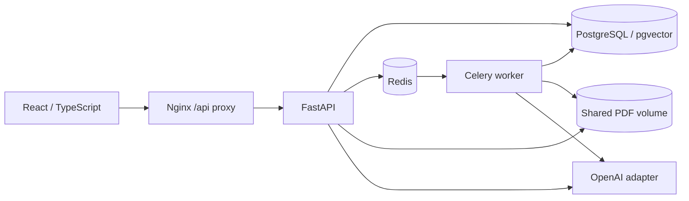

# Technical handover — Subject Knowledge Hub

Updated 2026-09-12. **Read this file first**, then open only the modules relevant to the requested change. It is a map of the implementation, not a requirement to reread all source. Search the function names below with `rg`; line numbers change after formatting.

Repository: https://github.com/xuantrung-DA/Subject-Knowledge-Hub
Owner's goal: a working Vietnamese/English PDF RAG portfolio application with reproducible CV metrics. No demo video. The supplied deployment is local Docker Compose.

## 1. Current state and first steps

1. Inspect `git status` and the current commit; do not print `.env`.
2. Follow [README](README.md) to start the stack. Expect five healthy services and migrate exit 0.
3. Read the data flow/invariants below before modifying the associated module.
4. Run relevant checks in an isolated test project and update this handover when contracts or architecture change.

The implementation run passed 90 backend tests (65 unit/contract + 25 database integration cases) and two Chromium application flows. Real OpenAI, worker interruption, 1,000-page processing and backup/restore were exercised. [Test report](docs/test-report.md) records that run; [publication review](docs/publication-review.md) records checks after cleanup.

Measured paired benchmark: 25.3% fewer provider input tokens on 70 held-out synthetic questions; 100% page Recall@6 on 56 answerable cases. External QASPER: 58.35% paragraph Recall@6 on 96 answerable cases. These are not general answer-accuracy claims. Three false refusals remain in the synthetic test, and independent human claim-support grading is unfinished.

Fresh clones use web/API ports 3000/8000. The original workstation uses 13000/18000 through its local env. Accounts, sessions, PDFs and API keys do not travel with Git.

## 2. System map



PostgreSQL is authoritative for domain state and job checkpoints. Redis is queue transport, rate-limit storage and answer cache. API and worker share `/data/pdfs`. Reconciliation threads in the API and worker parent recover eligible committed jobs. Worker concurrency defaults to one.

The frontend uses React hooks/local state, not Redux or a client router. Chat returns a complete JSON response, not SSE/token streaming. Normal runtime always uses `OpenAIProvider`; `TEST_MODE` does not silently switch to fake AI.

## 3. Backend file map

All application modules are under `backend/app/`.

| File | Responsibility and entry points |
| --- | --- |
| `__init__.py` | Package marker. |
| `main.py` | FastAPI `app`, JSON logs, request IDs, error handlers, request-body limit, health routes, lifespan reconciler. Router imports deliberately follow bootstrap. |
| `config.py` | Pydantic `Settings`; env loaded at import; model, budget, upload, retrieval, session and worker limits. Validates overlap and top-k/candidates. |
| `db.py` | Engine, `Base`, `SessionLocal`, `get_db`; callers own commits; failures roll back. |
| `models.py` | 16 ORM tables, keys, uniqueness and indexes; `new_id`, `utcnow`. API startup does not create tables. |
| `errors.py` | Shared `AppError(code, message, status_code)` for sanitized user-visible errors. |
| `security.py` | Scrypt passwords, opaque session-token hashes, CSRF/origin checks, Redis rate limits with process-local fallback; `current_user`, `require_subject`. |
| `api.py` | Auth/config; subject/document/version CRUD; upload/PDF; jobs/retry; conversations/history/usage. `store_upload`, `upload_version`, `public_job`, `scoped_jobs`, `citation_state`. |
| `chat_api.py` | Chat/summary request schemas and endpoints; calls `answer` / `create_summary_job`; preserves known usage when later AI steps fail. |
| `parser.py` | `PDFParser`, `ParsedPage`, normalization. pypdf text extraction; pdfplumber for ruled tables; bounded pages/chars, repeated-edge detection, scan/mixed warnings. |
| `chunking.py` | `TextChunk`, `chunk_pages`, Unicode-safe paragraph splitting, token overlap, table blocks, physical-page provenance and content hashes. |
| `ingestion.py` | `ingest_job`, `job_lock`, `_parse → _chunk → _embed → _activate`; durable batches, budget reservations, embedding cache and atomic active-version switch. |
| `worker.py` | `celery_app`, `dispatch_job`, `process_job`, `reconcile_jobs/loop`; ingestion/summary/evaluation dispatch, late acknowledgement, recovery and worker JSON logs. |
| `tokens.py` | Model-aware tokenizer helpers and `TokenBudget`; reserve calls/input/output before sending, including retry exposure. |
| `provider.py` | Sole production OpenAI adapter: `OpenAIProvider.embed/respond`, error classification, finite retries, usage/cost, `get_provider`. SDK retries disabled; adapter flushes usage, caller commits. |
| `retrieval.py` | `active_chunks` scope filters; `query_vector` cache; `retrieve` dense/lexical/hybrid; `rrf`; content dedup and context cap. |
| `rag.py` | Prompt, revision checks, history, answer cache, evidence registry/citations, direct/assistant modes, five tools, summary creation and resumable map/reduce execution. Search function names before editing this large file. |
| `evaluation.py` | JSONL/config schemas, mapping, retrieval/citation metrics, refusal proxy, token F1, exports; `PersistentEvaluationBudget`, `run_evaluation_job`. |
| `evaluation_api.py` | Scoped import/list/start/status/export; `create_run`, `enqueue_run`; validates server top-k and mapping. |
| `eval_cli.py` | CLI import/run/export and paragraph-corpus import; uses the same evaluator as the API. |

Bootstrap/dependencies:

- `backend/alembic/versions/0001_initial.py`: historical DDL snapshot; vector extension, 16 tables and indexes; dimensions substituted on first bootstrap. Add new migrations for schema changes.
- `backend/alembic/env.py`: settings/metadata and online/offline migration execution.
- `backend/alembic/script.py.mako`, `alembic.ini`: migration template/config.
- `backend/pyproject.toml`, `uv.lock`: locked Python dependencies, pytest markers and lint settings.
- `backend/Dockerfile`: frozen Python environment, tokenizer/font cache, source/scripts/fixtures, non-root runtime. Includes test tools.

## 4. Frontend file map

| Path under `frontend/` | Responsibility |
| --- | --- |
| `src/main.tsx` | Mount React and import styles. |
| `src/App.tsx` | Login/register, session/config bootstrap, subject sidebar/CRUD, tabs, selected scope, session-expired handling. |
| `src/Documents.tsx` | Upload queue/progress, job polling/retry, version replacement/deletion/details, `SummaryModal`, `JobDetails`, historical summary labels. |
| `src/Chat.tsx` | Conversations/history, direct vs assistant requests, answers, citation/PDF interactions, usage/debug/tool details. |
| `src/Evaluations.tsx` | JSONL import, document/version mapping, server-bounded top-k, run/poll/report/export; map metadata.target_document_key even without evidence. |
| `src/Common.tsx` | Icons/status/errors/loading, native dialogs, Markdown, progress and `PdfViewer`. No raw HTML; model-generated links/images do not load external resources. |
| `src/api.ts` | Same-origin fetch/XHR wrappers, in-memory CSRF header, timeout/error/request ID handling, upload progress, session-expired event. |
| `src/types.ts` | Auth/Config/Subject/Doc/Version/Job/Citation/Message/Answer/EvalRun contracts. Update with API response changes. |
| `src/style.css` | Desktop/mobile layout, panels, cards, modals, chat and evaluation styles. |
| `index.html` | Root HTML and entry module. |
| `vite.config.ts`, `tsconfig.json` | Dev/build/proxy and TypeScript checking. |
| `Dockerfile` | Node build followed by Nginx serving. |
| `nginx.conf.template`, `entrypoint.sh` | /api proxy, upload/body cap, timeouts, health/cache headers; validate settings before starting Nginx. |
| `package.json`, `package-lock.json` | Commands and locked npm dependencies. |
| `playwright.config.ts` | Single Chromium worker, configurable URL, failure traces/screenshots. |
| `tests/acceptance.spec.ts`, `tests/README.md` | Actual-stack offline flow and paid opt-in lifecycle flow; no route mocks. |

## 5. Database model

UUIDs are strings. Update JSON checkpoints by assigning a new dict; do not rely on SQLAlchemy tracking nested mutations.

| Table | Data / relationships |
| --- | --- |
| users | Unique email, password hash. |
| sessions | User FK, token hash, CSRF token, expiry. Raw opaque token stays in cookie. |
| subjects | Owner, name, corpus_revision, soft-delete. |
| documents | Subject FK, name/key, source_type, active_version_id, soft-delete. |
| document_versions | Document FK + unique version; SHA256/path, status/counts/errors, embedding model/dimension/config. |
| document_pages | Version FK + unique physical page number, extracted text, has_text. |
| chunks | Version FK + unique ordinal; text/tokens/hash, pages or paragraph IDs, vector/model/config. |
| jobs | Owner/subject/document/version, kind/status/progress/checkpoint/result, errors, attempts/heartbeat/enqueued timestamps. |
| conversations | Subject FK, title. |
| messages | Conversation FK, role/content/citations/debug, creation corpus_revision. |
| tool_runs | Message/user/subject, validated tool arguments, bounded result metadata/status/latency. |
| usage_events | User/subject/job/message, kind/model/tokens/cache/retries/latency and nullable estimated cost. |
| embedding_cache | Unique owner + content hash + model + dimensions. Query hashes have a separate prefix. |
| summaries | Unique version + config key + page range, content/status/job. |
| evaluation_runs | Owner/subject/job, reference dataset, mapping/config and report/status. |
| evaluation_results | Unique run + question ID + mode, durable result/error/evidence/usage. |

`alembic_version` is the 17th table in backup comparisons, not an extra domain table. PDF bytes live in the volume; vectors/pages/checkpoints live in PostgreSQL.

## 6. Processing flows

### Upload → active index

1. `Documents → api.upload_version`: authenticate scope; `store_upload` streams 1 MiB blocks to a UUID path, hashes/fsyncs and bounds filename/header/bytes.
2. Lock user admission, then subject/document consistently. An existing SHA256 in the subject returns the existing version/job and removes the redundant file.
3. Commit DocumentVersion + Job before `publish_after_commit → dispatch_job`. Broker failure leaves recoverable DB state and PDF.
4. `ingest_job` holds a PostgreSQL session advisory lock across stage commits; checks ownership/deletion/config.
5. Parse in page checkpoints; chunk from keyset-paginated pages with unique ordinals and durable progress.
6. Pin `chunk_page_boundaries` in the checkpoint. A legacy partial job without the flag stays cross-page. Other chunk parameters must remain stable during partial jobs.
7. Embed only missing vectors; cache by owner/model/dimensions/content. Reserve budget before calls, then commit vectors/cache/usage/checkpoint together.
8. `_activate` locks subject then document, checks complete vectors and live source, prevents an older replacement overtaking a newer active version, and increments corpus_revision.
9. Failures retain checkpoints. Scan-only PDFs become needs_ocr; source deletion cancels work. Failed replacements leave the previous complete version usable.

### Question → answer/citations

`Chat → chat_api.chat → rag.answer → _answer_impl` checks conversation ownership and captures revision. History only includes current-revision messages within its token cap.

Direct mode retrieves evidence using the question and relevant previous user turn, filters before ranking, assigns evidence IDs and calls Responses. An empty authorized corpus avoids a provider call.

Assistant mode offers five allowlisted tools: search_documents, read_document_pages, list_documents, summarize_document, get_job_status. Backend supplies user/subject scope; validated model arguments cannot override it. Tool output is bounded and fed back as function_call_output. No shell/web/arbitrary-code tool exists.

Only evidence actually sent to the model remains in the citation registry. `citation_cards` validates source/version/page IDs. Evidence without usable citations can produce a conservative refusal. Revision is rechecked during calls and before the final commit; changed corpus rejects a stale success.

Messages/tool traces/known usage are committed together. The chat endpoint preserves already-known usage if a later step fails. Direct answers without history can use Redis cache keyed by owner/subject/revision/model/prompt/config/retrieval parameters. Follow-up histories and evaluation disable inappropriate answer-cache reuse.

### Summary

`Documents.SummaryModal → chat_api.summary → create_summary_job` validates active version, range and budget/confirmation. Tool-triggered summary always requires explicit UI confirmation; a chat answer cannot authorize the job.

`run_summary_job` reads the entire chosen range, maps bounded units, reduces summaries and persists intermediates/reservations. Cache is version/config/range-specific. Historical output remains visible with replaced/deleted labels; retry against an inactive source is rejected.

### Evaluation

Import validates strict JSONL IDs/fields/evidence and maps document_key to authorized versions. Starting creates a durable job with frozen revision/config/mapping. Each question/mode result commits separately; resume skips existing pairs.

Retrieval-only calls `retrieve`; generation calls the same `answer` pipeline once, without an extra preliminary retrieval. Prior turns are replayed from questions, never reference answers. Reference answers remain outside indexes/prompts. Per-question errors remain reportable; exhausted budget or changed revision can stop the run.

Page/paragraph evidence are distinct units. Citation validity, refusal phrase matching and token F1 are proxies, not independent human correctness. CSV exports escape formula prefixes.

### Recovery

API and worker parent run reconciliation. Queued/unpublished or stale active jobs are republished only after the reconciler can acquire the advisory lock; a live worker is not force-unlocked. Late ack/reject-on-worker-loss and prefetch=1 support redelivery.

Defaults: stale 180 s, reconcile 30 s. Recovery experiments used 10 s/1 s. Delivery is at-least-once with durable idempotency; provider billing is not exactly-once because a timed-out request may have completed remotely.

## 7. API map

Base `/api`; current contract is `/api/openapi.json`, Swagger `/api/docs`. IDs below are abbreviations.

| Group | Routes |
| --- | --- |
| Public | GET /config, /health/live, /health/ready |
| Auth | POST /auth/register, /auth/login, /auth/logout; GET /auth/me |
| Subjects | GET/POST /subjects; PATCH/DELETE /subjects/{sid} |
| Documents | GET/POST /subjects/{sid}/documents; POST /{did}/versions; DELETE /{did}; GET /{did}/pdf?version_id=...; POST /{did}/summary |
| Jobs | GET /subjects/{sid}/jobs and /jobs/{jid}; POST /jobs/{jid}/retry |
| Conversations | GET/POST /subjects/{sid}/conversations; GET /conversations/{cid}/messages |
| Chat / usage | POST /subjects/{sid}/chat; GET /subjects/{sid}/usage |
| Evaluation | GET/POST /subjects/{sid}/evaluations; POST /{rid}/run; GET /{rid} and /{rid}/export |

Child paths in a row extend that row's resource prefix. Mutations require the authenticated session and X-CSRF-Token returned by auth/me. PDF requests require authentication. Error envelope: `{error:{code,message},request_id}`.

## 8. Invariants to preserve

- Scope/owner/deletion/active-version/model filters run before SQL ranking/LIMIT.
- Commit before queue publication; PostgreSQL owns job state.
- Never activate partial vectors or roll active_version backward on out-of-order replacements.
- Keep lock order: user admission → subject → document. Existing mutation locks use NO KEY UPDATE semantics compatible with FK key-share reads.
- Keep checkpoints and reservations on restart. Do not change chunk parameters/model/config mid-job without a defined migration/restart path.
- Never silently redirect an old citation to a new PDF version.
- Keep reference answers out of prompts/indexes; preserve dev/test separation and frozen comparisons.
- Fake providers are explicit test injections; runtime has no silent fallback.
- Reserve before provider requests; bound retries; unknown usage is not zero.
- Schema evolution uses new Alembic revisions, not rewriting initial DDL.
- Keep env/secrets, user PDFs, backups, DB dumps, browser traces, installed dependencies and generated builds out of Git.
- Preserve published benchmark scope; Recall@6 must not become an answer-accuracy claim.

## 9. Scripts map

All entries below live in `scripts/`. AI/benchmark scripts generally run inside the backend Linux image with PYTHONPATH=/app. Scale/recovery use Linux resource/process APIs. Host backup/restore only require Python 3.10+ and Docker.

| Script | Purpose / constraints |
| --- | --- |
| fixtures.py | Original regression PDFs, lifecycle/JSONL manifests; malformed/scan/encrypted files are intentional fixtures. |
| portfolio_fixtures.py | Ten runbooks, 50 pages, 100 QA; document-separated 30/70 split and hashes. Do not regenerate published fixtures casually. |
| validate_portfolio.py | Verify fixed hashes and every PDF page against source text, no API. |
| live_smoke.py | HTTP smoke with 10 questions/five tools; dry-run default, --execute-paid, optional --register isolated account. |
| verify_live_tools.py | Paid follow-up on existing smoke state for read-page contents/summary confirmation. |
| portfolio_benchmark.py | Baseline/page × dev/test, persisted state, cache disabled, token caps, explicit paid opt-in. |
| benchmark_summary.py | Paired statistics and blank human-review CSV from existing artifacts. |
| qasper.py | Download/hash/selection adapter, paragraph corpus and evaluation fixtures; network, no OpenAI. |
| qasper_benchmark.py | Real embedding index + three retrieval modes; paid opt-in, no answer generation. |
| scalability_smoke.py | Large synthetic PDF and deterministic embeddings; --database uses real production ingestion/pgvector. |
| live_scalability.py | Paid 1,000-page embeddings, three anchor answers and incremental three-page test; process/function measurements. |
| recovery_probe.py | Three real Celery SIGKILL/reconciliation trials in test DB/Redis15. |
| recovery_probe_worker.py | Test-only injection pauses batch two; requires TEST_MODE, empty key and explicit probe directory. Never import in runtime. |
| state_snapshot.py | Read-only table counts/row fingerprints, PDF hashes and usage totals; no row-content dump. |
| backup.py | Stop writers, snapshot PostgreSQL/PDFs + hashes, restart previously running services; --project-name. |
| restore.py | Validate archive/hash/path, replace target DB/PDFs, clear target Redis, migrate/restart; requires --replace-data. |

## 10. Test map and commands

| File under backend/tests/ | Coverage |
| --- | --- |
| test_core_unit.py | Password/origin/rate limit, schema compile, bounded uploads/cleanup, public config/health/errors/docs. |
| test_core_integration.py | Auth/CSRF/ownership, parallel dedup, publish failure, version/delete and summary lifecycle. |
| test_parser_chunking.py | Corrupt/encrypted/scan/mixed, repeated edges, tables, Unicode, exact-page provenance. |
| test_ingestion_budget.py | Retry reservation envelope, stable lock key. |
| test_ingestion_integration.py | Resume/idempotency/cache, pinned strategy, replacement order/failure, deletion during embedding, queue failure. |
| test_rag_units.py | Token accounting, tool schema/scope, SQL filtering, RRF, cache, provider retries/incomplete output. |
| test_rag_integration.py | Scoped modes, citations/history revision, corpus change during calls, tools, resumable summary. |
| test_sdk_contract.py | SDK wire/usage/function outputs, embedding order, timeout retries with mocked HTTP; no paid calls. |
| test_evaluation.py | Dataset/schema, page/paragraph metrics, proxies, exports, budget, fixture/QASPER adapter. |
| test_evaluation_integration.py | Real DB run/resume/export/scope, no answer leakage/duplicate retrieval, revision abort, server top-k. |

```bash
docker compose -p subject-hub-test -f compose.yaml -f compose.test.yaml run --build --rm tests
docker compose -p subject-hub-test -f compose.yaml -f compose.test.yaml down
```

Pytest declares `pythonpath = ["."]` in backend/pyproject.toml, relative to the backend root. This lets the CI command `uv run --frozen pytest` import `app` without Docker's `PYTHONPATH=/app`; do not remove it when changing test execution.

RUN_INTEGRATION=1 makes unavailable DB/Redis fail instead of skip. Never run integration/recovery against user data. Down retains volumes; use -v only for an intentional reset of the selected test project.

Frontend: format:check, typecheck, build, then offline Playwright on the running stack. Paid browser coverage includes valid PDF/dedup, exact page 4 citation/PDF iframe, evaluation export, summary, failed/successful replacement, stale/deleted summary. Browser traces can contain sessions and stay local.

CI definitions: .github/workflows/ci.yml runs lint/format, backend PostgreSQL/Redis tests, frontend checks and actual-stack offline Chromium. reliability.yml is manual recovery + deterministic 1,000-page DB smoke. No paid key is required by CI.

## 11. Configuration and operations

- .env.example is public; .env is local. Compose sets database/Redis/storage to service names and shared-volume paths.
- compose.yaml runs the app. compose.test.yaml adds isolated tests with an empty key. compose.live-smoke.yaml reduces budgets; do not use it as the ordinary large-PDF profile.
- Pass -p consistently for another project. Backend image tag is shared locally; named volumes remain project-specific.
- Default limits: 100 MiB, 1,200 pages, chunk600/overlap80, top-k6/candidates20, context4500/output900, stale180/reconcile30.
- Embedding-space changes require fresh corpus/project or deliberate migration. Changing page boundaries affects new ingestion, not completed historical versions.
- PRICING_JSON + PRICING_UPDATED_AT provide optional estimates, not invoices. Per-job token/call limits are not a global USD billing cap.
- The owner's earlier $10 authorization applied to that testing effort; its recorded estimate was about $0.285. Do not assume an unlimited budget for future work.
- docker compose down retains user data. Backups exclude env/key; restore can replace target data. Use a fresh project/free ports for rehearsal. [Operations](docs/operations.md) has exact recipes.

## 12. Where to investigate or change

| Task / symptom | Entry point |
| --- | --- |
| Queued job stuck | worker dispatch/reconcile; Redis/worker health; enqueued/heartbeat; advisory lock and budget. |
| Upload job fails | Job error_code → parser/ingestion/provider; text-bearing PDF, limits, key/model. |
| Wrong citation page | chunking provenance → retrieval.evidence_item → rag.citation_cards → Common.PdfViewer. |
| False refusal despite evidence | rag._answer_impl/citation_cards, prompt/output cap and actual evidence. Use new dev data, not tuning on published held-out. |
| Weak retrieval | retrieval.py; test lexical query/reranking on separate dev data and measure quality/tokens together. |
| Stale summary displayed as current | api.public_job/scoped_jobs, rag.create_summary_job, Documents.JobDetails. |
| Add tool | Argument model + tool_schemas + execute_tool in rag.py; scope, budget, result/citation and round-trip tests. |
| Add API field | Backend schema/serializer + frontend/types.ts + consumer + relevant contract/integration assertion. |
| Add setting | config.py/.env.example/Compose as needed; /config if UI needs it; related cache/config version and docs. |
| Evaluation rejects input | evaluation.py/evaluation_api.py mapping/schema/top-k/revision/budget. |
| DB/API unhealthy | Migrate logs, original volume password, vector dimension; do not auto-delete volumes. |

## 13. Documents, evidence and backlog

- README.md: public introduction, quickstart, actual metrics and limitations.
- docs/architecture.md, ingestion.md, contracts.md: design/transaction details.
- docs/specification.md, initial-schema.sql: specification/schema snapshot; current migration/code govern implementation.
- docs/evaluation.md: dataset, metrics and CLI protocol.
- docs/acceptance_vi.md: Vietnamese UI acceptance instructions.
- docs/benchmark-report.md, cv-results.md: measured claims, denominators and failure analysis.
- docs/progress.md, portfolio-roadmap.md: state and original plan; “starting point” sections are historical.
- docs/test-report.md vs test-report-20260909.md: current implementation evidence vs original skipped-test environment.
- docs/publication-review.md: cleanup/release checks.
- artifacts/runs/20260910-implementation/: original live/offline/dev/held-out results, frozen config, negative results and ungraded human-review form.
- artifacts/runs/20260910-github/: post-cleanup verification. Root SOURCE_MANIFEST.json identifies this source; archived manifests preserve previous snapshots.
- fixtures/project/: regression PDFs/JSONL including intentionally invalid files; fixtures/portfolio/: frozen synthetic runbooks; fixtures/qasper-selection.json: official IDs/hash/attribution.
- NOTICE.md: data attribution. No blanket MIT license is implied for application source.
- .gitignore/.dockerignore: publication/build exclusions; .gitattributes/.editorconfig/ruff.toml: text/style rules; AGENTS.md: entry instruction for future agents.

Potential next work, only when requested: improve lexical retrieval on new dev data; analyze false refusals; independent human review; concurrency/load and public deployment engineering; OCR for a concrete use case. Do not inflate synthetic evidence into production claims.
