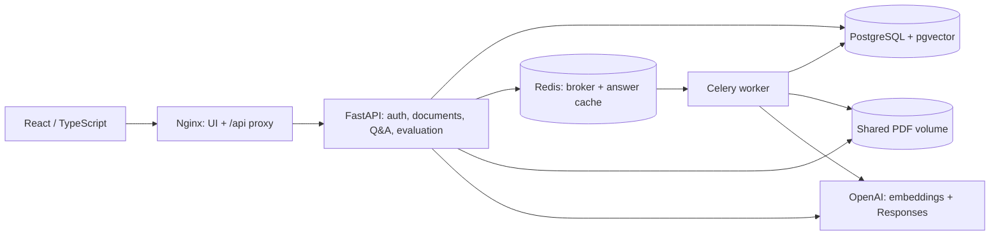

# Subject Knowledge Hub

A full-stack PDF knowledge application for Vietnamese and English study material. Organize PDFs by subject, ask questions with page-level citations, and inspect the evidence in the original document.

Built with **React, TypeScript, FastAPI, PostgreSQL/pgvector, Celery, Redis, and OpenAI**. The interface is in Vietnamese. The application runs locally with Docker Compose.

[Quickstart](#quickstart) · [Measured results](#measured-results) · [Architecture](#architecture) · [Tests](#tests) · [Agent handover](HANDOVER.md)

## What it does

- **Subject-scoped Q&A:** separate accounts, subjects and conversations; retrieve only authorized, active document versions.
- **PDF processing:** bounded uploads, text/table extraction, physical-page chunk boundaries, batched embeddings and progress tracking.
- **Citations:** open the exact document version and physical PDF page behind an answer.
- **Document lifecycle:** deduplicate uploads, replace versions, keep the previous version when replacement fails, and label historical sources.
- **Document tools:** search, list documents, read pages, request a summary, and inspect job status.
- **Recoverable work:** durable PostgreSQL checkpoints, Celery workers, advisory locks and reconciliation after interrupted jobs.
- **Evaluation:** import JSONL, map evidence to document versions, compare retrieval modes, and export JSON/CSV/Markdown results.
- **Usage accounting:** token/call budgets, bounded retries, cache tracking and optional dated cost estimates.

## Measured results

These are local measurements from 2026-09-10. Dataset scope and negative results are documented in the [benchmark report](docs/benchmark-report.md).

| Experiment | Result | Scope |
| --- | --- | --- |
| Page-boundary chunking vs cross-page baseline | **25.3% fewer provider input tokens** | Same 70 held-out synthetic Vietnamese/English questions |
| Evidence retrieval after the change | **100% page Recall@6** | 56 answerable synthetic questions; not general answer accuracy |
| Real OpenAI scale test | **1,000 pages in 41.0 s**, **263.9 MiB** peak process RSS | Synthetic PDF; includes ingestion and three retrieval checks; excludes whole-stack RAM |
| Incremental indexing | **One embedding batch** for three new pages | Existing 1,000 chunk IDs unchanged |
| Worker interruption | **3/3 jobs recovered**, no duplicate chunks | Real Celery/PostgreSQL/Redis; fixture embeddings; ten-second stale threshold |
| External QASPER retrieval | **58.35% paragraph Recall@6** | 96 answerable questions in a fixed 100-question subset; no generation |
| Backup/restore | **17 table fingerprints + 35 PDF hashes matched** | Restore into a separate Compose project |

The implementation verification passed **90 backend tests** (including 25 database integration cases) and **two Chromium application flows**. [Test report](docs/test-report.md) · [Publication review](docs/publication-review.md) · [CV statements](docs/cv-results.md).

## Quickstart

### Requirements

- Docker Desktop with Linux containers and Docker Compose v2.
- A machine with about 16 GB RAM; 6–8 GB available to Docker is a practical starting point.
- Internet access for the first build and for AI requests.
- Your own funded OpenAI API key for indexing, answers and summaries.

### 1. Clone and configure

```bash
git clone https://github.com/xuantrung-DA/Subject-Knowledge-Hub.git
cd Subject-Knowledge-Hub
```

**PowerShell:**

```powershell
if (!(Test-Path .env)) { Copy-Item .env.example .env }
notepad .env
```

**Bash / WSL:**

```bash
test -f .env || cp .env.example .env
# Edit .env using your editor.
```

Set `OPENAI_API_KEY` in `.env`. The file is ignored by Git and Docker builds. An empty key allows account and document management; AI operations return a configuration error. There is no automatic fake-provider fallback.

### 2. Start the application

```bash
docker compose up --build -d --wait --wait-timeout 180
docker compose ps -a
```

Wait for five healthy services: `postgres`, `redis`, `api`, `worker`, `web`. The one-shot `migrate` service should exit with code 0.

| Endpoint | Default address |
| --- | --- |
| Application | http://localhost:3000 |
| API documentation | http://localhost:8000/api/docs |
| API readiness | http://localhost:8000/api/health/ready |

If those ports are occupied, set `WEB_PORT` and `API_PORT` in `.env` and update `ALLOWED_ORIGINS` to the web origin. The original development workspace uses ports **13000/18000**; fresh clones use **3000/8000**.

### 3. Use it

Register an account → create a subject → upload a PDF with extractable text → wait for **Sẵn sàng** → ask a question → click a citation to open its PDF page.

Use the document panel to replace a PDF or create a summary over a page range. Use the evaluation panel to import a JSONL dataset and map each `document_key` to a document in the selected subject. A small dataset is included in `fixtures/project/`.

## Architecture



PostgreSQL owns job state and checkpoints; Redis transports work. Uploads commit a durable job before queue publication. The reconciler republishes eligible work after broker/process failures, and advisory locks serialize duplicate deliveries. A replacement becomes active only after all chunks are embedded.

Retrieval applies ownership, subject, deletion, version and embedding-space filters before ranking. Dense retrieval uses exact pgvector cosine search; lexical retrieval uses PostgreSQL full-text search; hybrid combines rankings with reciprocal rank fusion.

| Directory | Contents |
| --- | --- |
| `backend/app/` | API, authentication, ORM models, PDF pipeline, retrieval, RAG, tools and evaluation |
| `backend/alembic/` | Database migration and pgvector schema |
| `backend/tests/` | Unit, SDK-contract and real database integration tests |
| `frontend/src/` | Application shell, documents, chat, evaluation and shared UI |
| `frontend/tests/` | Playwright tests against the actual stack |
| `scripts/` | Fixtures, benchmarks, recovery probes, backup and restore |
| `fixtures/` | Original test PDFs, synthetic benchmark corpus and QASPER selection manifest |
| `artifacts/` | Published verification and benchmark evidence |
| `docs/` | Architecture, operations, evaluation, measured results and CV wording |

**For maintainers and coding agents:** read [HANDOVER.md](HANDOVER.md) first. It maps every code module, the data model, transaction boundaries, tests, known limitations and common change locations.

## Configuration

The complete template is [`.env.example`](.env.example); validation lives in `backend/app/config.py`.

| Setting | Default | Meaning |
| --- | --- | --- |
| `OPENAI_CHAT_MODEL` | `gpt-4.1-mini` | Answer generation and tool calling |
| `OPENAI_EMBEDDING_MODEL` | `text-embedding-3-small` | Document/query embeddings |
| `OPENAI_EMBEDDING_DIMENSIONS` | `1536` | Fixed dimension of an existing index |
| `MAX_UPLOAD_MB` / `MAX_PDF_PAGES` | `100` / `1200` | Upload and physical-page limits |
| `CHUNK_TOKENS` / `CHUNK_OVERLAP_TOKENS` | `600` / `80` | Chunk target and overlap |
| `CHUNK_PAGE_BOUNDARIES` | `true` | Preserve page provenance for new ingestion |
| `RETRIEVAL_MODE` / `RETRIEVAL_TOP_K` | `dense` / `6` | Retrieval strategy and evidence limit |
| `MAX_CONTEXT_TOKENS` / `MAX_OUTPUT_TOKENS` | `4500` / `900` | Ordinary answer limits |
| `JOB_STALE_SECONDS` | `180` | Stale-job detection threshold |

The paired benchmark used a smaller frozen context/output configuration; see its report. Changing the embedding model/dimension requires a fresh corpus or deliberate migration/reindex. Changing chunk settings does not rewrite existing versions. API and worker settings must match.

After editing runtime settings:

```bash
docker compose up -d --force-recreate api worker web
```

## Tests

### Backend

The command below creates a separate test project with actual PostgreSQL/pgvector and Redis. Test providers are explicitly injected; it makes no paid OpenAI calls.

```bash
docker compose -p subject-hub-test -f compose.yaml -f compose.test.yaml run --build --rm tests
docker compose -p subject-hub-test -f compose.yaml -f compose.test.yaml down
```

### Frontend

Use Node.js 22.18+:

```bash
cd frontend
npm ci
npm run format:check
npm run typecheck
npm run build
npx playwright install chromium
npm run test:browser -- --grep "actual stack"
```

Start the application first. Set `SKH_BROWSER_URL` if you changed the web port. The default browser flow makes no paid calls. The second flow requires explicit live opt-in; it also exercises summaries and document replacement. [Browser instructions](frontend/tests/README.md).

### Python style and CI

From `backend/`, using the locked development environment:

```bash
uv sync --frozen
uv run --frozen ruff check . ../scripts
uv run --frozen ruff format --check . ../scripts
```

The push/PR workflow runs Python lint/format, backend integration, frontend checks and the offline browser flow. A separate manual workflow runs controlled worker recovery and the deterministic 1,000-page test. CI does not need an OpenAI key.

Paid benchmarks default to dry-run and require `--execute-paid`. Reproduction instructions and corpus licenses are in [the evaluation guide](docs/evaluation.md) and [benchmark report](docs/benchmark-report.md).

## Operations

```bash
docker compose logs --tail 100 api worker migrate
docker compose restart worker
docker compose down
docker compose up -d
```

`down` preserves named volumes. `down -v` deletes project data.

Backup from the host with Python 3.10+:

```bash
python scripts/backup.py --project-name subject-knowledge-hub --output backups
```

The archive contains application data, not the API key. Restore into a separate project with the same embedding configuration and free ports; the restore command requires `--replace-data`. See [operations](docs/operations.md) for the full procedure and troubleshooting.

## Known limits

- Text-bearing PDFs are supported. Scanned documents need external OCR; images, complex formulas and perfect table reconstruction are not supported.
- Lexical retrieval scored 0% recall on the measured natural-language subsets; hybrid matched dense in that experiment.
- Three answerable synthetic held-out questions still produced false refusals. Independent human grading of every answer/claim remains unfinished.
- Valid citation coordinates do not prove that every answer claim is supported.
- Scale/recovery results are controlled local tests, not concurrency, uptime or production latency guarantees.
- The supplied Compose stack binds to loopback. Public hosting, TLS and multi-user production operations require additional deployment work.

Project fixtures and third-party dataset attribution are documented in [NOTICE.md](NOTICE.md).
