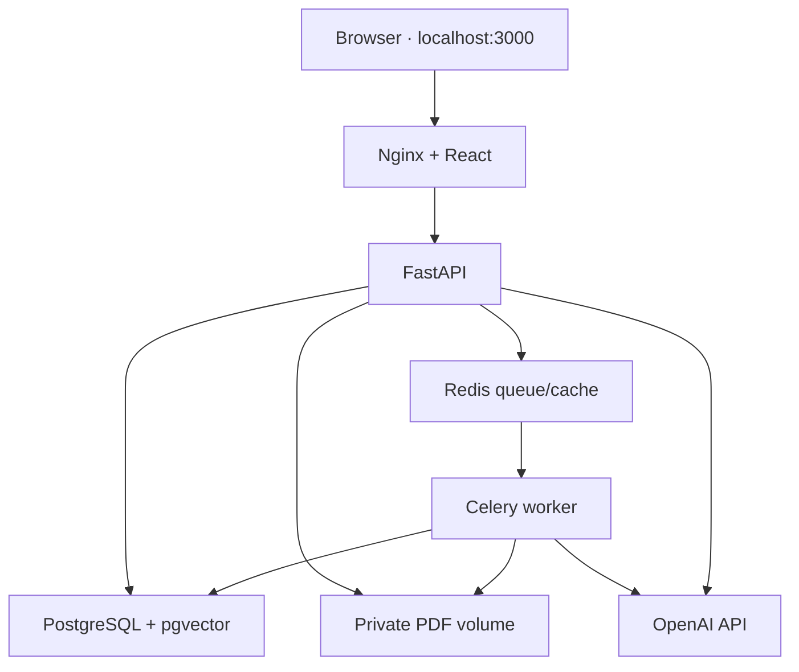

# Architecture and decisions

This document describes the implemented boundaries and the reasons behind them. Execution evidence belongs in [test-report.md](test-report.md).

## Local topology

The API port is also published on loopback for OpenAPI inspection. PostgreSQL/Redis remain inside the Compose network. API and worker share a persistent volume; an authenticated ownership-checking route serves PDFs, never an Nginx static uploads directory. The browser uses one origin for cookies, mutations and PDF reads. Secrets are backend environment values.

Compose waits for PostgreSQL readiness, completes the one-shot Alembic migration, then starts API/worker after Redis readiness. Web waits for API readiness. Process liveness and dependency readiness are distinct routes; missing OpenAI credentials are surfaced as configuration information rather than hiding the entire application.

## Persistence and ownership

| Data | Scope / invariant |
| --- | --- |
| Users and sessions | Password hashes and hashed session tokens; HttpOnly cookie; CSRF token for mutations |
| Subjects | Owner ID and corpus revision; one logical collection in a shared database |
| Documents / versions | Stable document ID, immutable version ID, active pointer switched only after completion |
| Pages / chunks | Physical page mapping, text/token counts, embedding model/config identity; unique version/page or version/ordinal |
| Jobs | Durable owner/subject/version scope, phase, progress, checkpoints, attempts and heartbeat |
| Conversations / messages | Subject-local history and saved revision; citations retain exact source version |
| Tool runs / usage | Scope, sanitized arguments, duration, outcome and actual provider-reported tokens |
| Summaries / evaluations | Version/config keys or separately imported datasets; evaluation references never enter retrieval index |

Every resource lookup rechecks ownership through its subject. Retrieval applies user, subject, deletion and active-version conditions in SQL before ranking. Tool scope is injected by the authenticated server, never supplied by model arguments. Redis metadata filters are not authorization.

## Upload, ingestion and recovery

1. API validates the subject owner, streams upload to a safe generated path, and enforces the file byte limit. Original filenames are display metadata.
2. A file hash and subject/document transaction coordinate duplicate/replacement uploads. The API commits a document version and durable job before attempting queue publication, then returns IDs.
3. Worker obtains the job claim, parses physical pages through the shared parser adapter, and persists phase/checkpoint progress. Scan-only content becomes `needs_ocr`; partial text produces a warning.
4. Paragraph-aware chunking uses token counts, overlap and preserved page ranges. Embeddings are batched by count/tokens, cached within user/model/dimension scope, and recorded incrementally.
5. In a final transaction the worker verifies deletion state and completeness, moves the active-version pointer, and increments corpus revision. A failed replacement leaves the previous active version usable.
6. Deletion removes the document from new retrieval immediately and advances revision. A late worker cannot activate a deleted document. Historic citations retain their version and acquire replacement/deletion labels.

Queue publication and database commit cannot form one atomic transaction. The PostgreSQL job record plus bounded reconciliation closes the “commit succeeded, publish failed” window. Celery acknowledgement/redelivery is at-least-once: claims, uniqueness, version activation checks and checkpoints are responsible for safe repetition. Recovery can repeat a provider request whose outcome was lost; provider-side billing is not exactly-once.

The default worker concurrency is one. An API lifecycle reconciler and worker recovery loop inspect durable job state, including stale heartbeat recovery. Redis persistence helps restart behavior but is not the sole record of work.

## Retrieval, answers and tools

Dense retrieval uses exact pgvector distance in the already-authorized active corpus. This avoids approximate-index postfilter starvation for the intended local size; ANN can be evaluated later without weakening scope. Lexical retrieval uses PostgreSQL full-text `simple` plus a GIN expression index. `simple` is a multilingual baseline with limited Vietnamese linguistic handling, and is not called BM25. Hybrid combines ranks with Reciprocal Rank Fusion. Dense is the conservative default pending real-provider comparison; users can select all three modes for evaluation. Fake embeddings cannot justify a claim that hybrid improves live retrieval quality.

Candidate limits, deduplication, final top-k and explicit evidence-token budgets bound context. A response-local numeric citation map is built from supplied evidence; source identifiers/pages invented by the model are not accepted. Empty ready collections short-circuit before a model call. Relevant short history helps follow-ups; corpus revision changes prevent stale evidence entering new answer context.

Direct mode performs retrieval with fewer round trips. Assistant mode uses official Responses API function calls and validated schemas for five operations: search, read page ranges, list documents, request scoped summaries, and inspect job status. The server enforces scope, page/output bounds, allowlisted tools and maximum rounds. It stores execution traces, not hidden chain-of-thought. PDF instructions remain untrusted evidence and cannot grant new permissions.

Long summaries are hierarchical worker jobs, keyed by version/range/config. The UI must explicitly start/confirm expensive scope after seeing an estimate. Job token/call ceilings return an incomplete/error state when exhausted rather than silently dropping unread material.

## Budgets, usage and caches

Question limits apply across calls, including prompts/tool schemas/tool outputs and possible rewrites. Context/history/output ceilings remain independent. Ingestion and summary have their own token/call ceilings. Real provider responses supply usage; failed requests with unknown usage are not advertised as free.

Embeddings are reused only within user/content/model/dimension identity. Query embeddings have a TTL. Exact-answer caching includes authorization, subject/revision, model/config/prompt identity and applicable history; changes to corpus revision bypass stale answers. Errors are not successful cached answers. Dated user-provided pricing is optional; absent prices mean unknown cost, not zero cost.

The embedding vector dimension is bound to schema creation. Changing the embedding model—even with the same dimension—requires reindexing into a fresh corpus. The README documents a separate Compose project preserving the old volumes. Automatic mixed-space fallback is forbidden.

## Evaluation and operational boundaries

Project-owned fixtures and at least 50 curated regression questions test known facts, multiple languages, absent answers, conflicting evidence, revisions and injection text. They are not an independent or expert-reviewed benchmark. The QASPER adapter retains test IDs and paragraph evidence, keeps test questions/references out of article indexing, and uses a separate collection. Its full-text paragraphs do not acquire invented PDF pages.

Deterministic tests can inject a fake provider. Runtime only constructs the real OpenAI provider. PostgreSQL/Redis integration tests do not substitute SQLite. CI starts actual services; local Docker, browser automation and live OpenAI each require independent evidence in the test report.

Nginx streams request bodies to the API, bounds request size using the same file-limit setting plus multipart framing, and returns actionable proxy errors. Named volumes persist across normal `down/up`. Consistent backup stops writers and captures PostgreSQL plus original PDFs; restore validates checksums/paths, restores both, clears derived Redis state and runs migration before restart.

## Official technical references

Sources checked during implementation; these explain design constraints rather than constitute execution evidence.

- [OpenAI function calling](https://developers.openai.com/api/docs/guides/function-calling) and [Embeddings](https://developers.openai.com/api/docs/guides/embeddings): Responses tool-call/result structure, embedding dimensions and batching constraints.
- [GPT-4.1 mini](https://developers.openai.com/api/docs/models/gpt-4.1-mini): configured default capabilities; model access still depends on the account.
- [FastAPI background tasks](https://fastapi.tiangolo.com/tutorial/background-tasks/) and [Celery tasks](https://docs.celeryq.dev/en/stable/userguide/tasks.html): heavy worker jobs, acknowledgements, retry and idempotence.
- [Docker Compose startup order](https://docs.docker.com/compose/how-tos/startup-order/): health/completion conditions used for migration and dependency readiness.
- [uv in Docker](https://docs.astral.sh/uv/guides/integration/docker/): pinned uv, lockfile-based installation and environment isolation. This repository pins the locally available `uv 0.12.8`.
- [Nginx proxy module](https://nginx.org/en/docs/http/ngx_http_proxy_module.html): request buffering and proxy timeout controls.
- [pgvector](https://github.com/pgvector/pgvector): exact/approximate search and filtering trade-offs.
- [pypdf text extraction](https://pypdf.readthedocs.io/en/stable/user/extract-text.html): extraction limitations and distinction from OCR.
- [QASPER dataset](https://huggingface.co/datasets/allenai/qasper) and [Ragas faithfulness](https://docs.ragas.io/en/stable/concepts/metrics/available_metrics/faithfulness/): evaluation scope; faithfulness concerns consistency with context, not absolute truth.
